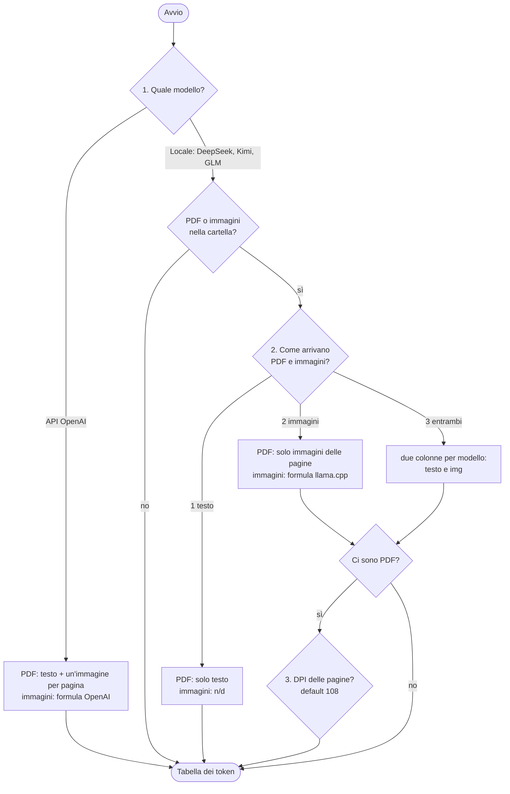

# Conteggio token

`count_tokens.py` conta i token che un modello vedrebbe per ogni file di una cartella: testo, PDF e immagini.
Serve a capire se un documento entra nel contesto del modello, quanto "pesa" e se conviene passare i PDF
come testo o come immagini.

Informazioni verificate il 27/10/2026 sui file ufficiali dei modelli, sul codice di llama.cpp e sulla documentazione
OpenAI (fonti in fondo).

## Uso

```bash
python3 -m venv .venv
.venv/bin/pip install -r requirements.txt

python3 count_tokens.py              # conta i file in ./input
python3 count_tokens.py /percorso    # conta i file di un'altra cartella
```

Lo script si rilancia da solo con il Python del `.venv` e fa al massimo due domande.

**1. Il modello.** Si può sceglierne uno, più di uno (`4 5 6` o `4,5,6`) o tutti (`t`); ogni modello diventa
una colonna della tabella.

```
Per quale modello contare i token?
  API OpenAI
    1) GPT-5.4 / GPT-5.5 / GPT-5.6
    2) GPT-5 / GPT-5.1
    3) GPT-4o / GPT-4.1
  Locale (llama.cpp)
    4) DeepSeek V3.2 / V4 / V4.1
    5) Kimi K2 / K2.5 / K2.6 / K3
    6) GLM-4.7 / GLM-5 / GLM-5.1 / GLM-5.3
  t) tutti, per confrontarli
Scelta (es. 1 oppure 1,4,5) [1]:
```

**2. Come arrivano PDF e immagini al modello locale.** Compare solo se hai scelto un modello locale e nella
cartella ci sono PDF o immagini:

```
Come arrivano PDF e immagini al modello locale?
  1) testo: dei PDF solo il testo estratto, immagini non lette (default di llama.cpp)
  2) immagini: ogni pagina del PDF diventa un'immagine, senza testo ("Parse PDF as image")
     serve la variante con visione: DeepSeek V4.1-Flash, Kimi K2.5 / K2.6, GLM-5.3-Flash
     ogni pagina costa un numero fisso di token, che dipende dai DPI e non dal testo
  3) entrambi, per confrontarli
Scelta [3]:
```

Con `3` ogni modello locale ha due colonne: `DeepSeek` (testo) e `DeepSeek img` (immagini).

**3. DPI delle pagine.** Compare solo se hai scelto `2` o `3` e nella cartella ci sono PDF:

```
A quanti DPI le pagine PDF diventano immagini?
  108 = valore fisso della web UI di llama.cpp, non uno standard. Se converti tu le pagine, i DPI che usi.
  Oltre una soglia il modello rimpicciolisce la pagina: i DPI in più non aggiungono token (pagina A4):
    DeepSeek   massimo 1,001 token, da 130 DPI
    Kimi       massimo 4,030 token, da 181 DPI
    GLM        massimo 7,952 token, da 252 DPI
DPI [108]:
```

Le soglie elencate sono solo quelle dei modelli scelti, calcolate con le stesse formule del conteggio.

Il DPI vale per i modelli locali. Per OpenAI le pagine restano a 150 DPI (`OPENAI_PDF_DPI`, un'ipotesi).
Le immagini (JPG, PNG…) non dipendono dal DPI: si usano i loro pixel.

Le risposte si possono passare da pipe, una per riga: `printf '4 5 6\n3\n200\n' | python3 count_tokens.py`.

Nella tabella:

- `n/d` → immagine che il modello, usato senza visione, non legge;
- `*` → totale calcolato senza i file `n/d`;
- `ERRORE` → file binario non supportato o illeggibile.

I tokenizer open-weight si scaricano da Hugging Face alla prima esecuzione (pochi MB, in `~/.cache/huggingface`).
Dopo funziona anche senza rete; per non fare nessuna richiesta: `HF_HUB_OFFLINE=1 python3 count_tokens.py`.

## Flowchart delle opzioni



Con `t` (tutti) si percorrono entrambi i rami: i modelli OpenAI non fanno la domanda 2, quelli locali sì.

### Perché non si chiede "API o locale?"

La risposta è già nella scelta del modello, quindi una domanda in più non cambierebbe i numeri:

- **OpenAI** esiste solo via API, e lì i PDF arrivano sempre come testo + immagini.
- **DeepSeek, Kimi e GLM** si possono usare anche via API del fornitore, ma il tokenizer è lo stesso:
  il conteggio del testo non cambia. Cambierebbe solo la gestione di PDF e immagini, che ogni servizio fa a modo
  suo e che non è documentata in modo verificabile. Lo script quindi li tratta come modelli locali su llama.cpp.

## Perché ogni modello dà un numero diverso

Un tokenizer è fatto di tre parti: una regex che spezza il testo in pezzi, un vocabolario e le regole BPE
che fondono i byte in token. Ogni famiglia di modelli ha il suo: lo stesso testo produce un numero di token
diverso, quindi **il conteggio OpenAI non vale per DeepSeek, Kimi o GLM**.

| Famiglia | Tokenizer | Vocabolario | Versioni con lo stesso tokenizer |
|---|---|---|---|
| OpenAI | tiktoken `o200k_base` | ~200k | GPT-4o, GPT-4.1, GPT-5.x, serie o |
| DeepSeek | BPE byte-level (`tokenizer.json`) | 128.000 + token speciali | V3.2, V4, V4.1 |
| Kimi | tiktoken con regex propria (`tiktoken.model`) | 163.584 + 256 speciali | K2, K2.5, K2.6, K3 |
| GLM | BPE byte-level (`tokenizer.json`) | 154.820 + 36 speciali | GLM-4.7, GLM-5, 5.1, 5.3 |

L'ultima colonna l'ho verificata scaricando i file dai repo ufficiali e confrontandoli:

- **Kimi e GLM**: i file sono identici byte per byte.
- **DeepSeek**: vocabolario e regole di merge coincidono, cambiano solo i token speciali (usati dal template
  di chat, non dal testo normale).

Per Kimi lo script ricostruisce il tokenizer con `tiktoken`, copiando la regex da `tokenization_kimi.py`:
non servono `transformers` né `trust_remote_code`.

### Quanto cambia in pratica

Solo testo, sui due PDF in `input/` (italiano giuridico):

| Tokenizer | Codice_Contratti_Pubblici.pdf (824 pag.) | LDB2025_ATTO COMPLETO.pdf (174 pag.) |
|---|---|---|
| OpenAI `o200k_base` | 434.660 | 254.936 |
| DeepSeek | 464.432 (+6,8%) | 261.443 (+2,6%) |
| GLM | 457.690 (+5,3%) | 266.362 (+4,5%) |
| Kimi | 515.219 (+18,5%) | 285.606 (+12,0%) |

## PDF: testo, immagini o entrambi?

Il modello non riceve mai un PDF: riceve token di testo e, se è un modello vision, immagini.
**Chi converte il PDF decide cosa arriva al modello**, quindi dipende dal programma che usi.

### API OpenAI: testo + immagine di ogni pagina

Con i modelli vision (da GPT-4o in poi) l'API estrae il testo **e** converte ogni pagina in immagine, e manda
entrambi al modello, anche se il testo è selezionabile. L'immagine serve a non perdere tabelle, colonne,
grafici e parti scansionate.

Le immagini pesano molto più del testo. Per una pagina A4 a 150 DPI (ipotesi dello script, `OPENAI_PDF_DPI`):

| Modello | Token per pagina (solo immagine) |
|---|---|
| GPT-5.4 / 5.5 / 5.6 | ~2.574 |
| GPT-4o / 4.1 | ~1.105 |
| GPT-5 / 5.1 | ~910 |

Sul Codice dei Contratti con GPT-5.4+ il totale arriva a ~2,56M token, di cui ~435k di testo.
OpenAI non dice a che risoluzione converte le pagine, quindi la parte immagini è un ordine di grandezza.

### Locale con llama.cpp: testo oppure immagini, mai entrambi

- **Web UI di `llama-server`**: per default **estrae solo il testo** (con PDF.js, nel browser).
  Nelle impostazioni c'è l'opzione *Parse PDF as image*, disattivata per default. Se la attivi e il modello è
  vision, ogni pagina diventa **solo un'immagine** (niente testo), renderizzata a scala 1,5 (108 DPI).
  Con un modello senza visione l'opzione viene disattivata automaticamente.
- **`llama-cli` o chiamate dirette all'API di `llama-server`**: nessuna gestione dei PDF.
  Il testo lo estrai tu (es. `pdftotext`, oppure `pypdf` come fa lo script) e lo mandi come testo.

Con estrattori diversi (PDF.js, pypdf, pdftotext) il testo cambia leggermente, e di poco anche il conteggio.

### Altri programmi locali

- **LM Studio**: se il documento entra nel contesto lo inserisce intero, altrimenti passa a RAG
  (manda al modello solo i pezzi pertinenti).
- **Open WebUI**: per default usa RAG (*Focused Retrieval*); per mandare tutto il documento c'è la modalità
  *Entire Document*.

Con RAG il conteggio del documento intero non corrisponde a quello che il modello legge davvero.

## PDF come immagini con i modelli locali

Per passare i PDF come immagini serve la variante del modello con visione **e** il suo proiettore (`mmproj`)
supportato da llama.cpp:

| Famiglia | Variante con visione in llama.cpp | Proiettore | Token per pagina A4 a 108 DPI |
|---|---|---|---|
| DeepSeek | V4.1-Flash | `deepseek41v` | 715 |
| Kimi | K2.5, K2.6 | `kimik25` | 1.442 |
| GLM | GLM-5.3-Flash | `glm5v` | 1.474 |

Le altre versioni (DeepSeek V3.2 e V4, Kimi K2, GLM-5, 5.1, 5.3) sono solo testo. Kimi K3 ha la visione,
ma il convertitore GGUF di llama.cpp per ora la scarta: in locale è solo testo.

Come si calcolano (dal codice di llama.cpp, con i parametri di default scritti nel `mmproj`):

- **DeepSeek V4.1-Flash**:
  1. l'immagine si divide in celle da 42 px (patch 14 × merge 3);
  2. ogni riga di celle aggiunge un token di "a capo", più 2 token di inizio e fine.
  3. Il blocco non supera 1.024 token: oltre, l'immagine viene rimpicciolita.
- **Kimi K2.5 / K2.6**:
  1. i lati vengono arrotondati a multipli di 28 px;
  2. un token ogni 28×28 px, al massimo 4.096 per immagine;
  3. più 2 marcatori.
- **GLM-5.3-Flash**:
  1. l'immagine viene messa su una tela con lati arrotondati per eccesso a 28 px;
  2. un token ogni 28×28 px, al massimo 8.000 per immagine;
  3. più 2 marcatori.

L'opzione `--image-max-tokens` di `llama-server` può cambiare questi limiti.

### Testo o immagini? I tuoi due PDF

| Modello | Codice (824 pag.) testo | Codice immagini | LDB2025 (174 pag.) testo | LDB2025 immagini |
|---|---|---|---|---|
| DeepSeek | 464.432 | 589.160 (+27%) | 261.443 | 124.410 (−52%) |
| Kimi | 515.219 | 1.188.208 (+131%) | 285.606 | 250.908 (−12%) |
| GLM | 457.690 | 1.214.576 (+165%) | 266.362 | 256.476 (−4%) |

Il costo di una pagina come immagine è fisso, quello del testo dipende da quanto testo c'è:

- **pagine poco piene** (Codice, ~560 token di testo per pagina): l'immagine costa di più;
- **pagine fitte** (LDB2025, ~1.500 token per pagina): l'immagine costa uguale o meno, con DeepSeek la metà.

**Meno token non vuol dire che il modello legga meglio.** A 108 DPI, con DeepSeek ogni token copre 42×42 px,
cioè diverse parole di un testo fitto. Per testo selezionabile il testo estratto è la scelta sicura. Le immagini
servono per tabelle, impaginazione o parti scansionate: in quel caso prova su qualche pagina se il modello le
legge correttamente.

## Dimensionare il contesto per i PDF come immagini

Il conto è **token per pagina × pagine**, più prompt e risposta.

### Token per pagina

Come immagine, una pagina costa un numero fisso di token. Dipende dai DPI e dalle dimensioni della pagina, non da
quanto testo contiene.

**108 DPI non è uno standard.** È il valore fisso della web UI di llama.cpp: PDF.js a scala 1,5 × 72 DPI. Se
converti tu le pagine (es. `pdftoppm -r 200`) i DPI li scegli tu: è la domanda 3 dello script.

**I DPI contano solo fino a una soglia.** Ogni modello ha un tetto di token per immagine. Oltre il tetto,
llama.cpp rimpicciolisce l'immagine finché ci sta: i DPI in più non aggiungono token e il dettaglio in più si perde.

Pagina A4, llama.cpp con i parametri di default:

| DPI | DeepSeek V4.1-Flash | Kimi K2.5 / K2.6 | GLM-5.3-Flash |
|---|---|---|---|
| 72 | 338 | 632 | 684 |
| 108 (web UI di llama.cpp) | 715 | 1.442 | 1.474 |
| 120 | 852 | 1.752 | 1.838 |
| 130 | **1.001** | 2.054 | 2.147 |
| 150 | 1.001 | 2.774 | 2.837 |
| 200 | 1.001 | **4.030** | 5.042 |
| 300 e oltre | 1.001 | 4.030 | **7.952** |

| Modello | Cella per token | Tetto per immagine | Pagina A4: massimo | Raggiunto da |
|---|---|---|---|---|
| DeepSeek V4.1-Flash | 42×42 px | 1.024 | 1.001 | 130 DPI |
| Kimi K2.5 / K2.6 | 28×28 px | 4.098 | 4.030 | 181 DPI |
| GLM-5.3-Flash | 28×28 px | 8.002 | 7.952 | 252 DPI |

Con pagine di altre dimensioni i massimi cambiano di poco, ma il tetto per immagine resta lo stesso.

**Perché DeepSeek costa meno.** Ogni token copre una cella più grande (42×42 px contro 28×28) e il tetto è più
basso. Esempio a 200 DPI:

1. Una pagina A4 è 1653×2338 px.
2. A piena risoluzione servirebbero 40×56 celle, più un "a capo" per riga e 2 token di inizio e fine: 2.298 token.
3. llama.cpp la riduce a 1092×1540 px: 26×37 celle + 37 "a capo" + 2 = **1.001 token**.

### Quanto contesto serve

Dipende da quante pagine arrivano nella stessa richiesta:

- **Tutto il PDF in una richiesta** (web UI con *Parse PDF as image*): `-c` ≥ pagine × token per pagina + prompt
  + risposta.
- **Una pagina per richiesta** (elaborazione pagina per pagina, come un OCR): `-c` ≥ token di una pagina + prompt
  + risposta, cioè qualche migliaio di token.

Con N richieste in parallelo (`-np N`) il contesto va moltiplicato per N.

Contesto massimo dei modelli (`max_position_embeddings` nel `config.json`) e i tuoi PDF interi a 108 DPI:

| Modello | Contesto massimo | LDB2025 (174 pag.) | Codice (824 pag.) |
|---|---|---|---|
| DeepSeek V4.1-Flash | 1.048.576 | 124.410 | 589.160 |
| Kimi K2.5 / K2.6 | 262.144 | 250.908 (resta poco per la risposta) | 1.188.208 → **non entra** |
| GLM-5.3-Flash | 1.048.576 | 256.476 | 1.214.576 → **non entra** |

Per questi tre proiettori llama.cpp decodifica i token dell'immagine in modo causale
(`mtmd_decode_use_non_causal` in `mtmd.cpp`). Quindi non serve `ubatch-size` ≥ token per immagine, come invece
succede con Gemma.

## Modelli locali (GGUF)

Il file GGUF contiene il tokenizer del modello originale (vocabolario, regole di merge e tipo di
pre-tokenizzazione), e llama.cpp ne reimplementa la regex. Il conteggio dello script coincide quindi con quello
di llama.cpp, salvo piccole differenze di implementazione.

Per il numero esatto sul GGUF che usi davvero (il testo dei PDF va estratto prima):

```bash
# con il programma llama-tokenize di llama.cpp: l'ultima riga è "Total number of tokens: N"
llama-tokenize -m modello.gguf -f documento.txt --no-bos --ids --show-count

# con llama-server già avviato (porta di default 8080), serve jq
jq -Rsc '{content: .}' documento.txt \
  | curl -s localhost:8080/tokenize -H 'Content-Type: application/json' --data-binary @- \
  | jq '.tokens | length'
```

Il numero va confrontato con il contesto impostato all'avvio (`-c` / `--ctx-size`). Nel contesto devono entrare
anche il prompt di sistema, il template di chat e la risposta del modello.

Il supporto dei modelli più recenti in llama.cpp arriva per gradi (es. DeepSeek V4). Prima di scaricare un GGUF
grande conviene verificare che la tua build lo carichi.

## Immagini con OpenAI

Le formule usate dallo script (detail `high`):

- **a tile** (GPT-4o, GPT-4.1, GPT-5, GPT-5.1):
  1. l'immagine viene ridotta per stare in 2048×2048;
  2. il lato corto viene portato a 768 px;
  3. si contano i quadrati da 512 px.

  Token = base + tile × numero di quadrati: 85 + 170 per GPT-4o/4.1, 70 + 140 per GPT-5/5.1.
  `gpt-4o-mini` ha valori molto diversi (2833 + 5667) e non è nel menu.
- **a patch** (GPT-5.4, 5.5, 5.6):
  1. il lato lungo viene ridotto a 2048 px;
  2. si contano le patch da 32 px;
  3. oltre 2500 patch l'immagine viene rimpicciolita.

  Token = patch × 1,2.

Le formule riproducono i numeri degli esempi nella documentazione OpenAI. Il default dell'API è `detail: auto`:
su GPT-5.5 e 5.6 equivale a `original`, che usa più patch e quindi più token.

## Limiti

- **Template di chat esclusi.** Non sono contati il template di chat né i token speciali, che aggiungono
  qualche token per messaggio.
- **Formule llama.cpp non provate su un modello reale.** Le formule per le immagini dei modelli locali sono
  ricavate dal codice di llama.cpp (ottobre 2026), non misurate eseguendo i modelli. Seguono i default del
  `mmproj`, quindi `--image-min-tokens` / `--image-max-tokens` le cambiano. Non coprono DeepSeek V4-Flash-Vision-Exp,
  che usa un proiettore diverso (`deepseek4v`).
- **Detail fisso.** Per OpenAI le immagini sono calcolate con detail `high`.
- **Risoluzione OpenAI ipotizzata.** I 150 DPI per le pagine sono un'ipotesi; i 108 DPI di llama.cpp invece
  vengono dal suo codice.
- **GPT-6 non è nel menu.** OpenAI non ha confermato che usi `o200k_base`; i test indipendenti danno conteggi
  identici.
- **Testi enormi in Kimi.** Il tokenizer ufficiale di Kimi spezza i testi oltre 400.000 caratteri o con sequenze
  senza spazi oltre 25.000 caratteri; lo script no. La differenza è trascurabile.

## Fonti

- OpenAI, tokenizer: [tiktoken – `tiktoken/model.py`](https://github.com/openai/tiktoken)
- OpenAI, immagini: [Images and vision – calcolo dei token](https://developers.openai.com/api/docs/guides/images-vision)
- OpenAI, PDF: [PDF files](https://developers.openai.com/api/docs/guides/pdf-files)
- DeepSeek: [DeepSeek-V4.1-Flash](https://huggingface.co/deepseek-ai/DeepSeek-V4.1-Flash) (`tokenizer.json`, `config.json` → `vision_config`),
  [DeepSeek-V4-Pro](https://huggingface.co/deepseek-ai/DeepSeek-V4-Pro),
  [DeepSeek-V3.2](https://huggingface.co/deepseek-ai/DeepSeek-V3.2)
- Kimi: [Kimi-K3](https://huggingface.co/moonshotai/Kimi-K3),
  [Kimi-K2.6](https://huggingface.co/moonshotai/Kimi-K2.6) (`preprocessor_config.json`),
  [Kimi-K2-Instruct – `tokenization_kimi.py`](https://huggingface.co/moonshotai/Kimi-K2-Instruct/blob/main/tokenization_kimi.py)
- GLM: [GLM-5.3](https://huggingface.co/zai-org/GLM-5.3), [GLM-5.3-Flash](https://huggingface.co/zai-org/GLM-5.3-Flash) (`processor_config.json`),
  [GLM-5.1](https://huggingface.co/zai-org/GLM-5.1), [GLM-4.7-Flash](https://huggingface.co/zai-org/GLM-4.7-Flash)
- llama.cpp, PDF nella web UI: [`convert-files-to-extra.ts`](https://github.com/ggml-org/llama.cpp/blob/master/tools/ui/src/lib/utils/convert-files-to-extra.ts),
  [`pdf-processing.ts`](https://github.com/ggml-org/llama.cpp/blob/master/tools/ui/src/lib/utils/pdf-processing.ts),
  [`settings.constants.ts`](https://github.com/ggml-org/llama.cpp/blob/master/tools/ui/src/lib/constants/settings.constants.ts)
- llama.cpp, immagini: [`mtmd-image.cpp`](https://github.com/ggml-org/llama.cpp/blob/master/tools/mtmd/mtmd-image.cpp),
  [`clip.cpp`](https://github.com/ggml-org/llama.cpp/blob/master/tools/mtmd/clip.cpp),
  [`mtmd.cpp`](https://github.com/ggml-org/llama.cpp/blob/master/tools/mtmd/mtmd.cpp),
  convertitori [`kimivl.py`](https://github.com/ggml-org/llama.cpp/blob/master/conversion/kimivl.py),
  [`kimi_k3.py`](https://github.com/ggml-org/llama.cpp/blob/master/conversion/kimi_k3.py),
  [`qwen3vl.py`](https://github.com/ggml-org/llama.cpp/blob/master/conversion/qwen3vl.py),
  [`deepseek41.py`](https://github.com/ggml-org/llama.cpp/blob/master/conversion/deepseek41.py)
- llama.cpp, conteggio: [`llama-server` README (`/tokenize`, `--image-max-tokens`)](https://github.com/ggml-org/llama.cpp/blob/master/tools/server/README.md),
  [`tokenize.cpp`](https://github.com/ggml-org/llama.cpp/blob/master/tools/tokenize/tokenize.cpp)
- llama.cpp, DeepSeek V4: [discussione sul supporto](https://github.com/ggml-org/llama.cpp/discussions/22376)
- LM Studio: [Chat with documents](https://lmstudio.ai/docs/app/basics/rag)
- Open WebUI: [RAG integration](https://www.mintlify.com/open-webui/open-webui/features/rag-integration)
- GPT-6 e tokenizer: [Simon Willison – ttok](https://simonwillison.net/2026/oct/9/ttok)
